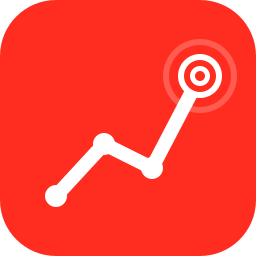

<p align="center">
  
</p>

<h1 align="center">Laravel Recordables</h1>

<p align="center">
  A lightweight Laravel package for recording snapshots of Eloquent model data over time.
</p>

## Installation

```bash
composer require bjthecod3r/laravel-recordables
```

Publish the config and migration:

```bash
php artisan vendor:publish --tag=recordables-config
php artisan vendor:publish --tag=recordables-migrations
php artisan migrate
```

## Quick start

```php
use BJTheCod3r\Recordables\Concerns\HasRecordings;
use BJTheCod3r\Recordables\Contracts\Recordable;
use Illuminate\Database\Eloquent\Model;

class Product extends Model implements Recordable
{
    use HasRecordings;

    protected array $recordable = [
        'price',
        'stock',
        'views',
    ];
}
```

```php
$product = Product::create([...]);  // creates a recording
$product->update(['price' => 200]);    // creates a recording
$product->record();                        // manual snapshot
```

For computed/derived snapshots, override `toRecording()` instead of
declaring `$recordable`:

```php
public function toRecording(): array
{
    return [
        'price' => $this->price,
        'profit_margin' => $this->calculateProfitMargin(),
    ];
}
```

## Recording API

```php
$product->record(
    data: ['price' => 200],
    changeType: 'synced',
    changeSource: 'cms_sync',
    causer: auth()->user(),
    recordedAt: now()->subDay(),
);

$product->recordIfChanged();
$product->recordSilently();
$product->recordOnQueue();
```

## Retrieval

```php
$product->recordings;                      // MorphMany relation
$product->latestRecording();
$product->firstRecording();
$product->recordingAt(now()->subWeek());
$product->recordingsBetween($start, $end);
```

## Analytics

All analytics helpers return immutable, JSON-serializable value objects.

```php
$history = $product->recordingHistory('price');           // History
$growth  = $product->recordingGrowth('price');            // Growth
$delta   = $product->recordingDelta('price');             // ?Delta
$minmax  = $product->recordingMinMax('price');            // ?MinMax
$trend   = $product->recordingTrend('price');             // Trend enum
$average = $product->recordingAverage('price');           // float
$chart   = $product->recordingChartData('price', 'day');  // ChartData

$growth->isPositive();
$growth->percentage;   // 50.0
$growth->toArray();    // JSON-friendly
```

Pass a `period` to switch from all-time growth to period-over-period:

```php
$product->recordingGrowth('price', period: 'month'); // this month vs last
$product->recordingGrowth('views', period: 'week');
$product->recordingGrowth('stock', period: 'day');
```

Boundaries are calendar-aligned via Carbon (`startOfWeek`, `startOfMonth`,
…), so `'week'` is "this week vs last week", not "last 7 days vs the 7 days
before that." Supported periods: `hour`, `day`, `week`, `month`, `year`.
Each side resolves to the **latest recording within its window** that
carries the metric.

Non-throwing variant for both modes:

```php
$product->recordingGrowthOrNull('price');
$product->recordingGrowthOrNull('price', period: 'month');
```

## Events

- `RecordingCreating` — cancellable; call `$event->cancel()` from a listener to skip persistence.
- `RecordingCreated` — fired after persistence.

When a recording is skipped (disabled, unchanged, or cancelled), `record()`
and `recordIfChanged()` return `null` — check the return value rather than
listening for a separate event.

## Testing

```php
use BJTheCod3r\Recordables\Facades\Recordables;

Recordables::fake();

$product->update(['price' => 100]);

Recordables::assertRecorded($product);
Recordables::assertRecordedTimes($product, 1);
Recordables::assertRecordedWith($product, fn ($data) => $data['price'] === 100);
Recordables::assertNotRecorded($otherProduct);
Recordables::assertNothingRecorded();
```

## Exceptions

All package exceptions extend `RecordablesException`:

- `MissingRecordableDefinitionException` — no `$recordable` property and no `toRecording()` override.
- `InvalidRecordableMetricException` — analytics asked for a metric absent from every recording.
- `InsufficientRecordingsException` — fewer than two comparable points (e.g., growth needs two).
- `NonNumericMetricException` — analytics ran against a metric stored as a non-numeric value (string, bool, array). Carries `metric`, `recordableClass`, and `actualType`.
- `RecordingFailedException` — persistence error wrapper used inside queued jobs.

Metrics stored as `null` are silently skipped (treated as "no sample this
time") so missing values from integrations don't break analytics.

## Pruning

```bash
php artisan recordables:prune --days=90
php artisan recordables:prune --keep=100 --model="App\Models\Product"
```

Schedule it:

```php
Schedule::command('recordables:prune')->daily();
```

## Per-model overrides

```php
class Product extends Model implements Recordable
{
    use HasRecordings;

    protected array $recordable = ['price', 'stock'];

    protected bool $recordOnCreate = true;
    protected bool $recordOnUpdate = true;
    protected bool $recordOnlyOnChange = true;
    protected ?int $keepRecordingsForDays = 90;
    protected ?int $keepRecordingsCount = null;
}
```

## License

MIT
